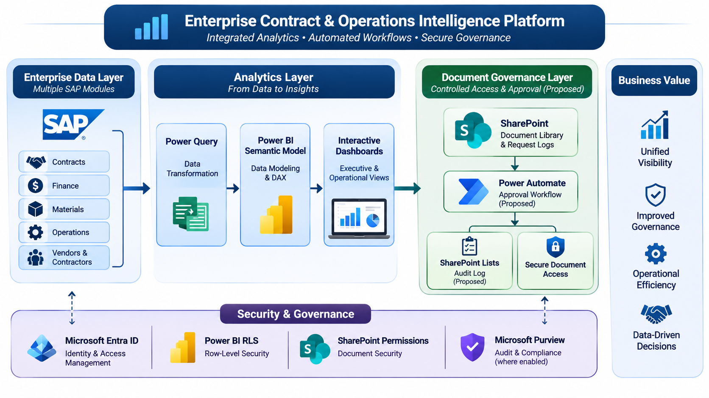
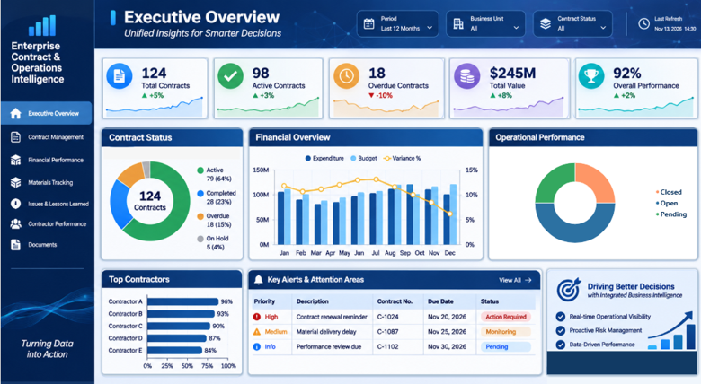

# Enterprise Contract & Operations Intelligence Platform

**An Integrated Enterprise Business Intelligence, Process Automation & Document Governance Solution**


---



## Executive Overview Dashboard Mockup


---

> **Confidential Enterprise Project**
>
> Client identity and industry are intentionally undisclosed due to confidentiality requirements.
>
> This case study describes the implemented BI solution and separately identifies proposed document governance enhancements. All portfolio visuals and illustrative examples are independent mockups and do not contain original client data.

---

## 1. Project Overview

The Enterprise Contract & Operations Intelligence Platform is an integrated Business Intelligence solution designed to improve visibility into contract management, financial performance, materials tracking, operational issues, and contractor performance.

The solution consolidates data from multiple SAP modules into a unified Power BI analytical environment, transforming fragmented enterprise data into structured insights and executive-level reporting.

It also incorporates a document management architecture based on SharePoint, with a proposed governance workflow for controlled document access requests and approval tracking.

### Core Objectives

- Centralize contract and operational reporting.
- Improve financial and contractual visibility.
- Monitor materials and contractor performance.
- Support proactive identification of operational risks.
- Provide secure access to contract-related documents.
- Establish a foundation for document governance and auditability.

## 2. Business Challenges

The project addresses several enterprise reporting and operational challenges:

| Challenge | Business Need |
|---|---|
| Fragmented enterprise data | Unified analytical reporting |
| Limited contract visibility | Centralized contract monitoring |
| Financial reporting complexity | Financial performance analysis |
| Material tracking difficulties | Improved material status visibility |
| Contractor performance monitoring | Consistent performance evaluation |
| Disconnected issue records | Structured issue and lessons-learned reporting |
| Distributed contract documents | Centralized document management |
| Document access governance | Controlled access and approval processes |

## 3. Solution Architecture

The solution is organized into two distinct architectural areas.

### A. Enterprise Data & Analytics — Implemented

**Data Sources → Transformation → Semantic Model → Analytics**

1. **Data Sources:** Multiple SAP modules.
2. **Data Transformation:** Power Query.
3. **Data Modeling:** Power BI Semantic Model.
4. **Business Logic:** DAX measures and KPIs.
5. **Reporting:** Executive and operational dashboards.

### B. Document Governance — Proposed

The document management architecture uses SharePoint Document Library as the document repository.

The proposed enhancement introduces:

- Document access requests.
- Manager approval workflow.
- Request and approval tracking.
- Controlled document access.
- Audit and compliance considerations.

**Implementation Status: Planned**

Power Automate and SharePoint Lists are proposed implementation components. These workflow capabilities are not part of the currently completed implementation.

## 4. Functional Modules

The platform includes seven analytical modules:

| Module | Description |
|---|---|
| Executive Overview | Consolidated executive KPIs and enterprise performance indicators |
| Contract Management | Contract status, timelines, and monitoring |
| Financial Performance | Financial indicators and contract-related analysis |
| Materials Tracking | Materials availability and tracking |
| Issues & Lessons Learned | Operational issues and lessons-learned analysis |
| Contractor Performance | Contractor evaluation and performance indicators |
| Contract Documents Management | Contract document organization and access interface |

## 5. Technology Stack

| Technology | Role |
|---|---|
| SAP | Enterprise data sources |
| Power Query | Data extraction and transformation |
| Power BI | Analytics and visualization |
| DAX | KPI calculations and business logic |
| SharePoint Document Library | Contract document repository |
| Microsoft Entra ID | Identity and access management |
| Power BI RLS | Report-level data access control |
| SharePoint Permissions | Document-level access control |
| Power Automate | Proposed approval workflow |
| SharePoint Lists | Proposed request and approval tracking |
| Microsoft Purview | Audit capabilities where configured and enabled |

## 6. Security & Access Management

Security is designed around separate access-control layers.

- **Microsoft Entra ID:** Identity and authentication.
- **Power BI Row-Level Security (RLS):** Controls access to analytical data within reports.
- **SharePoint Permissions:** Independently controls access to stored documents.

Access to a Power BI report does not automatically grant access to the underlying SharePoint documents.

Actual document access remains subject to SharePoint permissions.

Microsoft Purview may provide additional audit capabilities where the relevant services, policies, and licensing are configured.

## 7. Document Approval & Audit — Proposed Enhancement

**Status: Planned — Not Yet Implemented**

The proposed workflow is intended to introduce a governed process for document access requests.

### Proposed Process

1. A user requests access to a contract document.
2. The request is submitted for approval.
3. The designated manager reviews the request.
4. The approval decision is recorded.
5. The user receives the decision and accesses the document subject to SharePoint permissions.

### Proposed Components

- **Power Automate:** Workflow orchestration.
- **SharePoint Lists:** Request and approval records.
- **SharePoint Document Library:** Document storage and permissions.
- **Microsoft Purview:** Additional audit capabilities where enabled.

**Audit distinction:** Approval and request logs are not equivalent to actual document download logs. Actual document activity auditing requires an appropriately configured audit capability.

## 8. Business Value

### Implemented Capabilities

- Unified enterprise reporting across multiple data sources.
- Centralized contract and operational visibility.
- Financial and performance analysis.
- Structured contractor and materials monitoring.
- Executive-level decision support.
- Integrated document management architecture.

### Planned Enhancements

- Automated document approval workflow.
- Centralized approval request tracking.
- Enhanced document governance.
- Additional audit and compliance capabilities.

## 9. Repository Structure

```text
Enterprise-Contract-Operations-Intelligence/
│
├── README.md
├── DISCLAIMER.md
│
├── Architecture/
│   ├── solution-architecture.png
│   └── security-architecture.png
│
├── Dashboards/
│   └── executive-overview.png
│
├── Workflows/
│   └── proposed-document-approval.png
│
└── Documentation/
    ├── business-requirements.md
    ├── data-model.md
    └── security-and-governance.md
```

## 10. Project Information

| Attribute | Details |
|---|---|
| **Project Type** | Enterprise Business Intelligence & Document Governance |
| **Analytics Platform** | Microsoft Power BI |
| **Data Sources** | Multiple SAP Modules |
| **Document Repository** | SharePoint |
| **Core BI Status** | Completed |
| **Document Governance Workflow** | Planned |
| **Confidentiality** | Client identity, industry, source data, and internal implementation details are intentionally excluded from this public case study. |

---

*This repository presents a sanitized portfolio case study. It does not contain original client dashboards, confidential business data, proprietary source code, or internal system configurations.*
